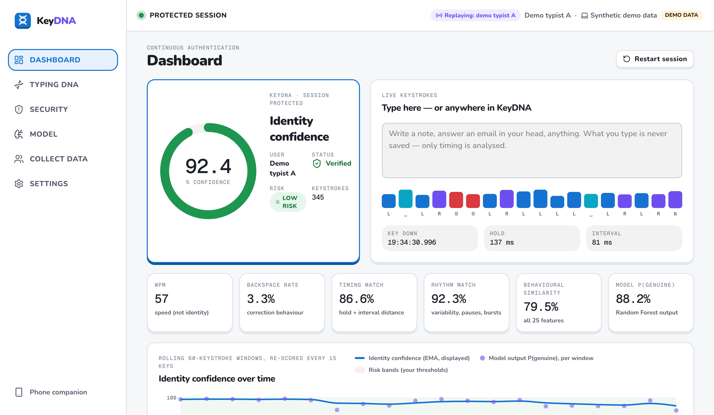
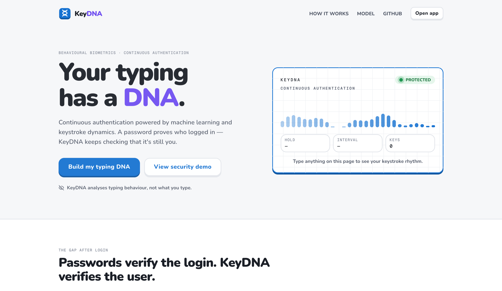
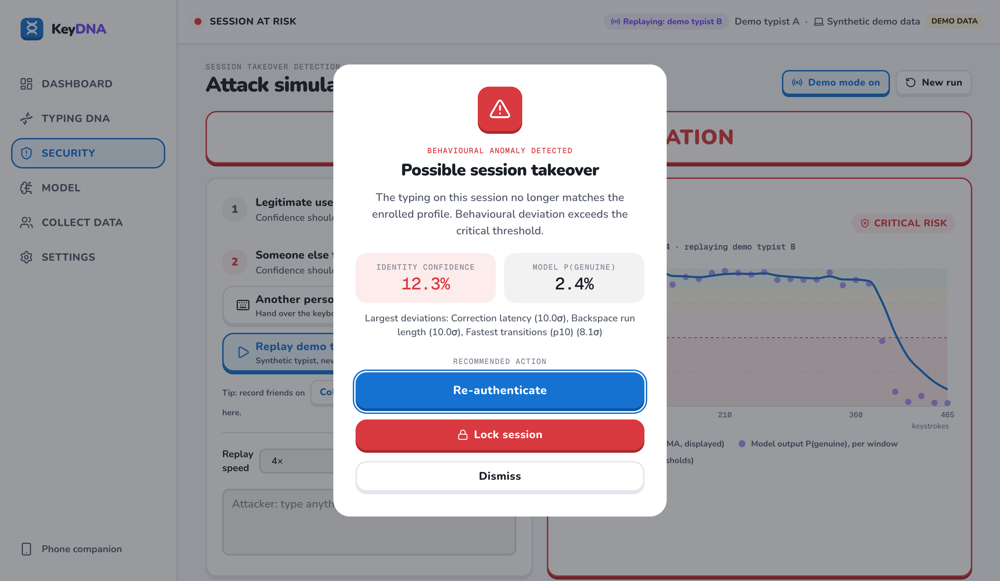
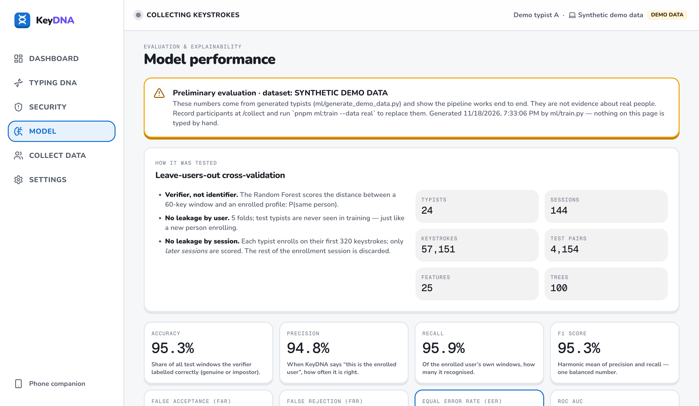
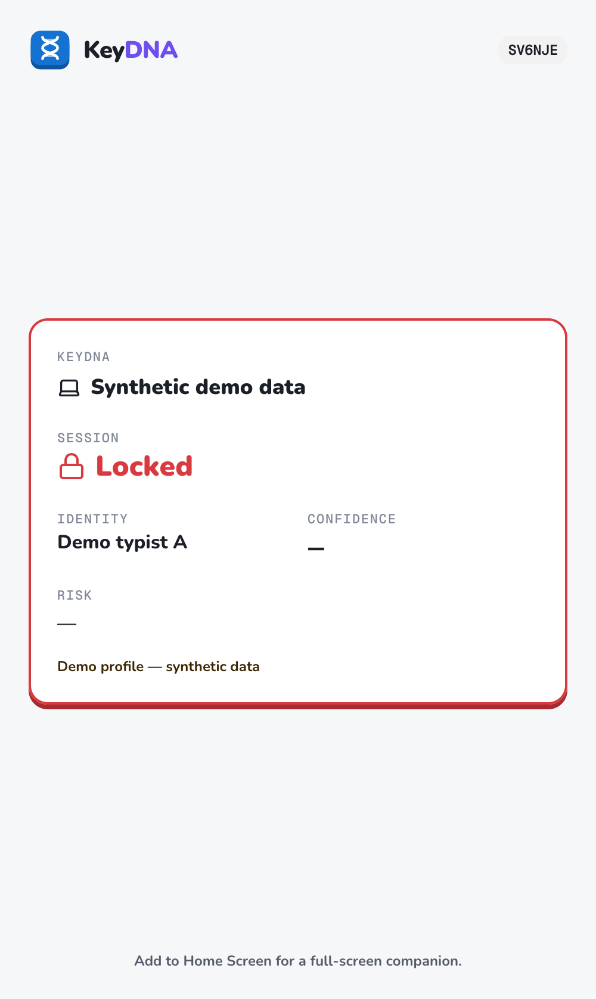

# KeyDNA

### Your typing has a DNA.

**KeyDNA: A Machine Learning-Based Continuous Authentication System Using Keystroke Dynamics**

A password proves who logged in. KeyDNA keeps checking that the person typing is still the person who logged in. It learns a behavioural profile from *how* you type: key hold times, inter-key intervals, rhythm, pauses, hand transitions and corrections. A Random Forest then compares every rolling window of 60 keystrokes against that profile. When the behaviour drifts far enough, KeyDNA raises a takeover alert and asks for re-authentication.



> **Honesty note.** The model and metrics shipped in this repo were trained on **synthetic demo typists** (`ml/generate_demo_data.py`). They show that the pipeline works end to end, but they are **not** evidence about real people. The app labels them "DEMO DATA / preliminary evaluation" everywhere. Record real participants at `/collect` and retrain with `pnpm ml:train --data real`.

---

## Contents

- [Problem](#problem)
- [Architecture](#architecture)
- [ML pipeline](#ml-pipeline)
- [Features](#features)
- [Installation](#installation)
- [Dataset](#dataset)
- [Training](#training)
- [Evaluation](#evaluation)
- [Screenshots](#screenshots)
- [Security model](#security-model)
- [Privacy](#privacy)
- [Limitations](#limitations)
- [Future work](#future-work)

## Problem

Authentication usually happens once, at login. After that, nothing checks whether the same person is still at the keyboard. That leaves a gap for:

- a stolen or hijacked session
- an unattended, unlocked computer
- account sharing and insider misuse

```
Traditional:  LOGIN → password/MFA → access granted → someone else takes over → … unnoticed

KeyDNA:       LOGIN → password/MFA → behavioural baseline
                    → every 15 keys: does the last 60-key window still match?
                    → match: continue · drift: risk rises · strong deviation: re-authenticate / lock
```

KeyDNA is an **additional risk signal**. It does not replace passwords or MFA.

## Architecture

```
┌──────────────────────── Browser (Next.js 16, TypeScript) ─────────────────────────┐
│ keydown/keyup ──► capture.ts ──► [down, up, hand-zone]   (never the character)    │
│                                   │                                               │
│                                   ▼                                               │
│         engine.ts: rolling 60-key window → features.ts (25 features)              │
│                                   │                                               │
│                     model.ts: σ-distance to profile → Random Forest (exported)     │
│                                   │  P(genuine)                 ← MODEL OUTPUT     │
│                                   ▼                                               │
│               EMA smoothing → identity confidence              ← SMOOTHED OUTPUT  │
│                                   ▼                                               │
│              thresholds → LOW / MEDIUM / HIGH / CRITICAL       ← UI RISK RULES    │
│                                   ▼                                               │
│              security events · takeover alert · simulated lock screen            │
└───────────┬───────────────────────────────────────────────┬───────────────────────┘
            │ optional: 25 features only                     │ status every 2 s
            ▼                                                ▼
   /api/predict (same TS scorer)                   /api/companion/[code] ◄── iPhone /companion
                                                                              (PWA, can lock)
┌──────────────────────── ml/ (Python 3.13, uv, scikit-learn) ──────────────────────┐
│ sessions → features.py → verifier.py (profiles, pairs, CV) → train.py              │
│        → models/keydna_model.joblib + metadata.json                                │
│        → public/model/keydna-rf.json (trees) + metrics.json → read by the web app  │
└───────────────────────────────────────────────────────────────────────────────────┘
```

| Path | What it is |
|---|---|
| `src/app/(marketing)` | Landing page |
| `src/app/(focus)/enroll` | Step-by-step enrollment: Monkeytype import → live calibration → profile |
| `src/app/(app)/dashboard` | Live continuous authentication |
| `src/app/(app)/security` | Attack simulation + security event log |
| `src/app/(app)/typing-dna` | Your behavioural profile |
| `src/app/(app)/model` | Metrics, ROC, FAR/FRR, confusion matrix, feature importance |
| `src/app/(app)/collect` | Record other people to build a real dataset |
| `src/app/(app)/settings` | Thresholds, smoothing, inference mode, companion pairing, privacy |
| `src/app/(focus)/companion` | Phone companion (responsive PWA) |
| `src/lib/keydna/` | Feature extraction, scorer, engine, Monkeytype parser: the TS side of the ML contract |
| `ml/` | Data generator, training, evaluation, export (Python) |

**Why the model runs in the browser:** the forest is trained in scikit-learn and exported as plain arrays. TypeScript walks those trees, so keystrokes never leave the device and the app deploys as a normal Next.js site. A parity test (`src/lib/keydna/parity.test.ts`) feeds Python-generated windows through the TS code and requires identical features, distances and probabilities.

## ML pipeline

1. **Capture.** Each keystroke becomes `[down_ms, up_ms, zone]`, where `zone ∈ {L, R, S(pace), B(ackspace), E(nter)}` comes from the physical key position. Password fields, auto-repeat, IME composition and shortcut chords are ignored.
2. **Windowing.** Predictions are made on rolling windows of **60 keystrokes**, re-scored every **15** (training uses a stride of 20). One key is never enough to judge.
3. **Features.** Each window yields 25 features (see below).
4. **Profile.** Enrollment (320 keystrokes ≈ 1 minute) is cut into overlapping windows (stride 10). The profile is the mean and σ of each feature.
5. **Distance.** `d_f = min(|x_f − μ_f| / max(σ_f, 0.05·|μ_f|, floor_f), 10)`: how many of *your own* standard deviations away the window is. `floor_f` stops a trait that never varied during enrollment (e.g. zero backspaces) from exploding.
6. **Verifier.** A Random Forest (100 trees, depth ≤ 10) takes the 25 distances and outputs **P(same person)**. Because it learns what genuine and impostor *distances* look like, it works for a brand-new user the moment they enroll, with no retraining. This is a user-independent verifier, not a multiclass "who is this" classifier, which is the right shape for continuous authentication.
7. **Smoothing.** `confidence = α·P + (1−α)·previous` with α = 0.35, so the score doesn't jump on every window.
8. **Risk engine.** Configurable thresholds on confidence: **LOW ≥ 85 · MEDIUM ≥ 70 · HIGH ≥ 50 · CRITICAL < 50**. Crossing into CRITICAL logs *Possible session takeover* and opens the alert.

## Features

| Group | Features |
|---|---|
| Key hold (dwell) | mean, σ, median; left-hand, right-hand and space-bar mean |
| Inter-key interval (flight, down→down) | mean, σ, median, p10, p90; cross-hand, same-hand, word-boundary means; cross/same ratio |
| Rhythm | coefficient of variation of intervals; release→press gap; rollover rate |
| Pauses & bursts | pause rate (600–2000 ms gaps), pause duration, mean burst length |
| Corrections | backspace rate, correction latency, backspace run length |
| Speed | WPM: included, but it carries ~0.4% of the importance. *Speed is performance; timing behaviour is identity.* |

**Monkeytype.** Imported history (ApeKey via a server proxy, or pasted JSON) becomes the **historical baseline**: speed, accuracy, consistency, and key spacing/duration statistics across tests. It feeds the profile's stability score and the history comparison on `/typing-dna`. Monkeytype's list endpoint omits key timing, so KeyDNA re-fetches the newest N results one by one. These calls are spaced 2.2 s apart because ApeKeys are limited to 60 result fetches per hour. The live model scores fine-grained windows from calibration, not Monkeytype aggregates.

## Installation

Requirements: Node 24, pnpm 10, [uv](https://docs.astral.sh/uv/) (it manages Python 3.13 for you). Runs locally on Apple Silicon.

```bash
pnpm install
pnpm dev                 # http://localhost:3000
```

The trained model is committed, so the app works immediately. To rebuild it:

```bash
pnpm ml:data             # regenerate synthetic demo typists (deterministic seed)
pnpm ml:train            # train + evaluate + export to public/model/
pnpm test                # vitest: TS ↔ sklearn parity, engine replay, Monkeytype parser
pnpm ml:test             # pytest: features, leakage checks, tree export
pnpm lint && pnpm typecheck && pnpm build
```

No environment variables are required.

## Dataset

See [docs/DATASET.md](docs/DATASET.md) for the session format. In short:

- **Synthetic demo set.** 24 training typists plus 2 held-out demo typists, 6 sessions each, about 360 keystrokes per session. Each typist has fixed traits (speed, hold length, hand-transition habits, pause and error behaviour) plus day-to-day drift between sessions.
- **Real data.** Record participants at `/collect`. Each session is 360 keystrokes, 2–5 sessions per person on different days. Export them, drop the file into `ml/data/raw/` (git-ignored, because this is personal data), then run `pnpm ml:train --data real`. `train.py` refuses to train on real data with fewer than 3 people having at least 2 sessions each.

## Training

`ml/train.py` loads → cleans (drops malformed events) → extracts window features → splits by user and by session → trains → evaluates → saves:

- `ml/models/keydna_model.joblib` and `ml/models/metadata.json` (feature names, version, training date, dataset hash, thresholds). No scaler is saved: forests don't need one, and the per-user profile *is* the normalisation.
- `public/model/keydna-rf.json`: the exported forest the browser runs
- `public/model/metrics.json`: everything `/model` shows
- `public/demo/demo-pack.json`: held-out demo typists for the no-login security demo
- `src/lib/keydna/__fixtures__/parity.json`: the Python ↔ TS parity fixture

### Leakage control

- **By user.** Leave-users-out 5-fold cross-validation. Test typists are never seen in training, just like a new person enrolling.
- **By session.** Each typist enrolls on their first 320 keystrokes, and only *later sessions* are scored. The rest of the enrollment session is thrown away, so no probe window sits next to enrollment data in time.
- **Demo holdout.** The two typists replayed in the web demo are excluded from training *and* evaluation.

## Evaluation

Synthetic demo data, leave-users-out CV (24 typists, 4,154 test pairs):

| Metric | Random Forest | Scaled-Manhattan baseline |
|---|---|---|
| ROC AUC | 0.989 | 0.969 |
| EER | 4.9% | 9.5% |
| Accuracy / Precision / Recall / F1 (P ≥ 0.5) | 95.3% / 94.8% / 95.9% / 95.3% | — |
| FAR / FRR (P ≥ 0.5) | 5.3% / 4.1% | — |
| Continuous replay: takeovers detected | 98.0% (median 80 keystrokes) | — |
| Continuous replay: genuine false alarms | 5.0% of sessions | — |

The scaled-Manhattan detector is the classic anomaly-detection baseline in keystroke dynamics. All numbers are regenerated by `train.py`; `/model` reads them from `metrics.json` and explains each one in plain language. The per-feature σ floors were chosen by a sweep on this synthetic CV, so re-check them on real data.

## Screenshots

| | |
|---|---|
|  |  |
|  |  |

## Security model

- **Defends against:** a different person taking over an authenticated session (session hijacking with physical/remote keyboard use, an unattended unlocked machine, account sharing).
- **Response:** warning events → *Possible session takeover* at CRITICAL → **Re-authenticate**, **Lock session** or **Dismiss**, each logged with timestamp, severity, confidence and explanation. The lock screen is **simulated**; KeyDNA never locks the operating system.
- **Layering:** password/MFA + KeyDNA behavioural verification + device/context signals. KeyDNA is one layer.
- **Robotic input:** enrollment rejects calibrations no human could produce (sub-15 ms holds, > 250 wpm).

## Privacy

> KeyDNA analyses typing behaviour, not what you type.

- Never stored: passwords (password inputs are skipped entirely), typed text, messages, browser content.
- Captured: key-down/up timestamps and hand zone only.
- Kept in `localStorage` on this device: the profile (feature means ± σ), security events, Monkeytype numbers, recorded sessions. There is no server-side database.
- **Process locally** is on by default. Server inference sends only the 25 derived features plus the profile statistics.
- The Monkeytype ApeKey passes once through `/api/monkeytype` and is never stored or logged.
- Common letter-pair timings shown on `/typing-dna` are computed in memory during calibration and stored only as aggregates on this device.

## Limitations

- **The evaluation is synthetic** until real participants are collected. Real typing is messier: different keyboards, fatigue, multitasking.
- **Spoofable in principle.** A knowledgeable attacker who has studied a victim's timing could imitate it. KeyDNA is a risk signal, not a perfect biometric.
- **Free-text, single keyboard layout:** hand zones assume a QWERTY-style physical layout, and only typing inside the KeyDNA web app is monitored (browsers can't see other apps).
- **Companion relay is in-memory.** It works for `pnpm dev` on a LAN or a single warm Vercel instance. A multi-instance deployment needs Redis or Supabase Realtime.
- Impurity-based feature importance can favour correlated features. Treat it as a ranking.

## Future work

Mouse and touch dynamics · device fingerprinting · browser/location context · typing on mobile · federated and on-device learning · LSTM / Transformer sequence encoders and Siamese metric learning on raw key sequences · multi-modal behavioural biometrics · enterprise SSO integration and adaptive MFA · Supabase-backed profiles and realtime companion.

## Academic positioning

Keystroke dynamics and continuous authentication are established research areas (see, e.g., Killourhy & Maxion, 2009, for the benchmark anomaly detectors). KeyDNA's contribution is an **accessible, explainable implementation**: browser-based capture, Monkeytype-assisted enrollment, a user-independent verifier with leakage-controlled evaluation, live explainability, attack simulation, a phone companion, and privacy-first feature extraction. See [docs/VIVA.md](docs/VIVA.md) for short answers to common viva questions.
